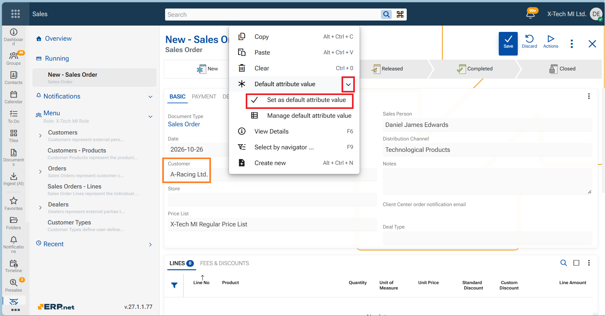
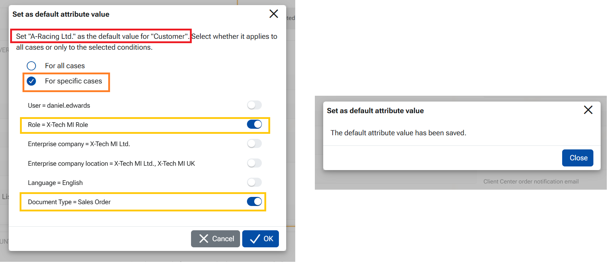

# Default attribute value

*also known as "Entity attribute default value", "Default value"

In the Web Client, you can save a field’s current value as a default. The setting is stored in System/Internal system data/**Entity Attribute Default Values**

Technical information may be found [HERE](https://docs.erp.net/tech/advanced/concepts/default-value.html)

## Prerequisites: 

To access "Default attribute value"—including "Set as default attribute value" and "Manage default attribute value"—the user must meet both requirements:

- Be a member of a user group granted the Global Layout Manager system permission - this permission is managed through the Desktop client
- Have Is Layout Admin enabled for their current user–role assignment - may be managed through the WEB client

If either requirement is not met, the options are not available. 

## Create a default attribute value

The examples here are carried on a Sales Order - Customer field.

1. Open a new Sales Order in the Web Client - document type "Sales Order"
2. Select a record for the Customer field, e.g. "A-Racing Ltd"
3. Open the Customer field’s three-dot context menu.
4. Select **Default attribute value** → **Set as default attribute value.**

5. In the dialog, review the field and value you are about to save.
6. Select any conditions that should restrict when the default applies—for example, the current user, role, enterprise company, company location, language, or sales order document type. Only the conditions you select will restrict the default.

- If you mark "For all cases" -no conditions, "A-Racing Ltd" becomes an unconditional default that will be applied when a new sales order of **any** document type is created. 
- If you mark "For specific cases" and select conditions, the value will be applied when the chosen conditions are met.

Let us choose conditions per Role and per Document type.

7. Select OK to save the Default attribute value.
   

This creates a record in table "Entity Attribute Default Values". 

The value consists of Repository name, Attribute name, Default internal value - the ID of the Customer, Default text value of the Customer - A-Racing Ltd, The Role - reference and Condition Entity Category - the ID of the document type.

This Default value will be applied at the creation of a new Sales order when the conditions are met. 

In the example Customer will be automatically set to "A-Racing Ltd" when a new order of document type "Sales Order" is created, by a user whose role is "X-Tech MI Role". If an order of a dfferent document type is created, the Customer will be empty (as normal).

## Manage the default attribute values

In order to edit or delete a Default attribute value the user needs to access the navigator "Entity attribute default values"

From the record itself:
1. Open the Sales order - in edit mode
2. Open the Customer field’s three-dot context menu.
3. Select **Default attribute value** → **Manage default attribute value.** 
   The navigator will open filtered by the Repository and the Attribute.
4. Edit the desired record

## Set another default value for the same field

In order to change the default value for the same field, follow the steps to **Set as default attribute value.**. In case the new value has the same conditions (e.g. per Role and per Document Type) and only the value itself is defferent, the system will not create a new record, but will actually change only the two fields - Default internal value and the Default text value.

Цветанка, here is a draft **if–then list** for the Desktop documentation. I’ve kept it to behavior observed in your sales-order tests.

## Impact of Entity Attribute Default Values on the Desktop Client

The Desktop Client can apply defaults stored in the new **Entity Attribute Default Values** entity, even though those settings were created through the Web Client. When defaults for the same field exist in both entities, the Desktop Client uses the following precedence:

!!! behavior is verified with sales orders, field Customer

*old entity - Data Entry Default Values, Default Values
*new entity - Entity Attribute Default Values, Default Attribute Values

1. If an applicable default exists in the old entity, then the Desktop Client applies that value. This remains true even if a default in the new entity matches more conditions.
2. If no applicable default exists in the old entity, but an applicable default exists in "Entity Attribute Default Values", then the Desktop Client applies the value from the new entity.
3. If no applicable default exists in the old entity, and there is a default in the new entity "For all cases" it will be applied in the Desktop Client
4. If the session context changes while a document is open, then the Desktop Client does **not** automatically refresh that document’s default values.The user needs to change or reopen the document, so that the system could check the new conditions and apply the correct default value.
5. If there are two defaults with the same or different conditions for one and the same field, saved in the two entities the default from the old table will be applied in the Desktop client.

As a conclusion - if a default has been saved within the old table (from the Desktop's interface) it will be preferred over the default save under the Web Client interface. 

**Examples:** Suppose the old entity specifies **Customer = A-Racing Ltd.** and the new entity specifies **Customer = Naselenie**. If both settings are applicable, the Desktop Client uses **A-Racing Ltd.** 

> [!IMPORTANT]
> Check applicable settings in both entities before adding a new default. A setting created through the Web Client may affect Desktop users, but an applicable setting in the old entity takes precedence there.

