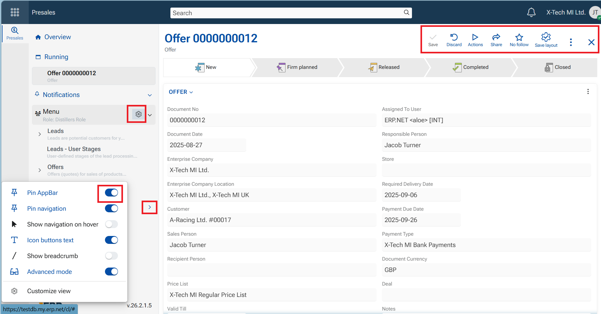
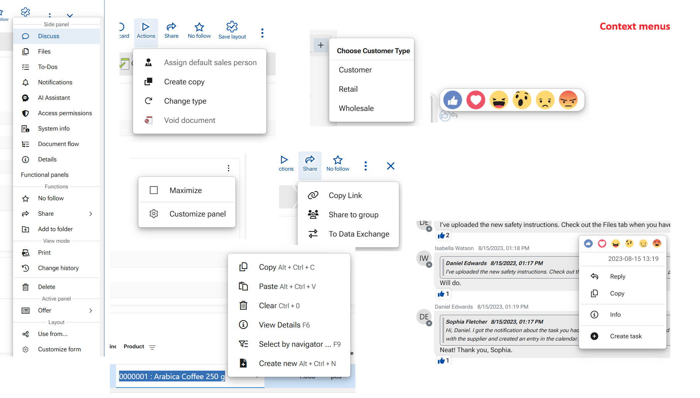

# Overview of @@webclient interface

The ERP.net Web Client interface includes a range of intuitive symbols, elements, buttons that provide quick access to core functionality. 

## Interface Symbols

- **Kebab menu (⋮)**: Opens a dropdown menu with contextual options. Typically located on the right side of a panel.
- **Gearwheel** ⚙️: Provides access to system or contextual settings.
- **Square/rectangle with a pencil**: Represents the option to view, enter, or edit an entry, such as a document, product, or user profile.
- **Plus sign (+)**: Used to create a new entry.
- **Right angle bracket (>)**: Expands a collapsible menu or section.
- **Bell** 🔔: Notification icon. An orange circle with a number indicates new alerts (e.g., someone mentioned you or updated a tracked document).
- **House**: Navigates to the home page of the module ("Overview").
-  **Pin** 📌: Used to fix or unfix panels. 
  - A diagonal pin means you can pin the item.  
  - A vertical pin means it's already pinned.
- **Star** ⭐: Marks the item as important.
- **On/Off toggle**: (toggle switch) Activates or deactivates specific functions or views.
- **Funnel**: Opens a search or filtering function, usually within navigators.
- **Chevron (ˇ)**: Opens a dropdown menu.
- **Sqare**: maximizes the panel
- **Magnifying lens** 🔍: a place to input search text

---

### 2. Functional Elements

These are the core elements, the structure of @@webclient that present data and are actually the tools to navigate and execute tasks.

[**App bar**](interface/app-bar.md) 

A vertical sidebar that appears when you click the Start menu (if not pinned). It provides access to all ERP.net applications and their subsystems.

[**Navigation panel**](interface/navigation-panel.md)

Displays the components of the currently open application, including records, settings, and favorites. This is the shortcut to reach the desired entities and operate within the module.

[**Side panel**](interface/side-panels.md)

A side panel is a context-sensitive panel on the right side of the screen. Available options depend on the active form and may include additional, context-specific features such as document routes, discussions, advanced filters, functional panels, and access permissions.

> [!Note]  
> Side-panel tools are context-based and always relevant to the currently opened record.

[**Navigators**](https://docs.erp.net/webclient/navigators/index.html)

Navigators organize and display data in a structured, interactive table format.

- Records are typically sorted by **Document Date** in descending order (newest first)
- Columns can be sorted using up/down arrows
- Each column includes a **funnel icon** for filtering and searching
- Records are opened by clicking the value in the first column, which acts as a direct link to the record form

**Home page**

Represents the module by several main panels, that define its structure and components (entities). The main panels contain Definitions, Documents and operations, Setup, Reports and Ledgers. Each one further consists of and reveals corresponding categories, namespaces and report-views.

**Single-record form**  

Every record exists within its own form. This form may consist of several panels.
The main panel bears the name of the entity itself, and is usually called "the main panel". It contains the essential fields that define the record - the definition.
Other panels supply related or detailed information connected with the current record and can be displayed and organized per the needs.

**Panel** 

Panels structure both application home pages and individual record views. Types include:
  - Main panels
  - Detail panels
  - Related data panels
  - Widget panels

## Command tools

These consist of Command buttons and Context menus. Follow the links to learn in details how to use the command tools.

### [Command buttons](../../commands/buttons.md)

An essential part of the ERP.net Web Client interface. They perform actions ranging from saving and closing entries to initiating processes, navigating between views, and interacting with documents and data. These buttons are typically displayed at the top of panels and forms, or in the context menus, providing direct access to frequently used commands and functionalities.

Each command button consists of a text and a symbol that visually reinforces its purpose, helping users understand its function at a glance. Symbols (icons) are so carefully selected, so that the button actually becomes a sign and even the text can be omitted (not shown) because thus it intuitively represent the action performed.

All command buttons also include helpful tooltips that appear when hovered over, providing users with clear hints about the button’s function before clicking.

While some command buttons are standardized across the system (e.g., Save, Close, Delete, Print), and others are contextual and appear depending on the type of record or process being handled. 

### [Context menus](../../commands/context_menus.md)

Context menus vary widely depending on the element, feature, or field they serve. They contain operations specific to the panel, form, field, or feature currently in use. Context menus may also be attached to buttons—for example, the Run button includes a context menu with multiple functions.

These menus are indicated either by a three-dots icon or a down-arrow on the button itself, or they can be revealed by right-clicking on an element (for example, a field or a comment).

